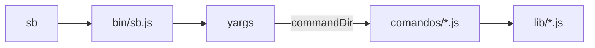

# 🛠️ sb

CLI personal para el flujo de trabajo de *Rediseños de Apps viejas*: lista proyectos, revisa la bandeja de conocimiento, audita dependencias y más, todo desde la terminal.


## Dos ramas, dos propósitos

| Rama | Para qué sirve |
|---|---|
| `master` (esta) | Herramienta para nuestro flujo de trabajo (*Rediseños de Apps viejas*): el CLI `sb`. |
| [`aprendizaje`](../../tree/aprendizaje) | Versión didáctica para aprender yargs, Node y JavaScript moderno (yargs 18, ESM, async/await). |

## Historia corta

Nació en 2020 como un ejercicio de tablas de multiplicar con yargs 16. En 2026 se analizó ([informe `.docx`](_analisis/analisis-001-bases-nodejs.docx) y [versión `.md`](_analisis/analisis-001-bases-nodejs.md)) y se partió en dos: `master` se volvió una herramienta útil y `aprendizaje` conservó el ejercicio, modernizado, como material de estudio.

## Instalación

Requiere Node 20 o superior.

```
npm install
npm link      # deja disponible el comando `sb` en tu PATH
sb --help
```

Sin `npm link` también sirve: `node bin/sb.js <comando>` o `npm start -- <comando>`.

### SB_RAIZ

La raíz de trabajo es, por defecto, la carpeta dos niveles arriba de este repo (`..\..`). Para usar otra:

```
set SB_RAIZ=D:\otra\raiz         (cmd)
$env:SB_RAIZ = 'D:\otra\raiz'    (PowerShell)
```

## Comandos

| Comando | Qué hace | Ejemplo |
|---|---|---|
| `sb proyectos` | Lista las carpetas `NNN-nombre` de la raíz con rama git y si tienen `.docx` en `_analisis/` | `sb proyectos` |
| `sb nuevo <nombre>` | Crea `NNN-slug/_analisis/img/` con el siguiente número | `sb nuevo "Mi Rediseño"` |
| `sb abrir <proyecto>` | Abre el proyecto (número o parte del nombre) en el Explorador; `--editor` usa VS Code | `sb abrir 1 --editor` |
| `sb bandeja` | Lista las notas de `_conocimiento-global/bandeja/` | `sb bandeja` |
| `sb audit [proyecto]` | `npm audit` (solo lectura) de los proyectos con `package-lock.json` | `sb audit 001` |
| `sb clips <carpeta>` | Videos de una carpeta con duración y resolución (requiere `ffprobe`) | `sb clips D:\Clips` |
| `sb tablas -b <n> [-l 10]` | Tabla de multiplicar (recuerdo del proyecto original) | `sb tablas -b 7 -l 3` |

Los errores salen por stderr con código de salida 1.

### Salida de muestra

```
$ sb proyectos
PROYECTO          RAMA    DOCX
001-bases-nodejs  master  sí

$ sb bandeja
2026-11-23  Analizar una app Node vieja sin tocarla, y delegar el análisis

Total: 1

$ sb tablas -b 7 -l 3
7 x 1 = 7
7 x 2 = 14
7 x 3 = 21

$ sb --help
sb <command>

Comandos:
  sb abrir <proyecto>  Abre un proyecto (número o parte del nombre) en el
                       Explorador, o con --editor en VS Code
  sb audit [proyecto]  Corre npm audit (solo lectura) en los proyectos con
                       package-lock.json
  sb bandeja           Lista las notas de _conocimiento-global/bandeja/
  sb clips <carpeta>   Lista los videos de una carpeta con duración y resolución
                       (solo lectura)
  sb nuevo <nombre>    Crea NNN-nombre/_analisis/img/ con el siguiente número
  sb proyectos         Lista los proyectos NNN-nombre de la raíz
  sb tablas            Imprime la tabla de multiplicar (recuerdo del proyecto
                       original)

Opciones:
      --version  Muestra número de versión                            [booleano]
  -h, --help     Muestra ayuda                                        [booleano]
```

## Cómo funciona



## Estructura

```
bin/sb.js        punto de entrada: configura yargs y carga comandos/
comandos/        un archivo por comando (abrir, audit, bandeja, clips, nuevo, proyectos, tablas)
lib/             lógica pura y ayudantes (config, exec, proyectos, tablas, ...)
test/            pruebas con node:test
_analisis/       análisis del proyecto original (2026)
```

## Agregar un comando

Crea `comandos/<nombre>.js` exportando `command`, `describe`, `builder` y `handler`; se registra solo con `commandDir`. La lógica pura va en `lib/` con su prueba en `test/`.

## Pruebas

```
npm test
```
