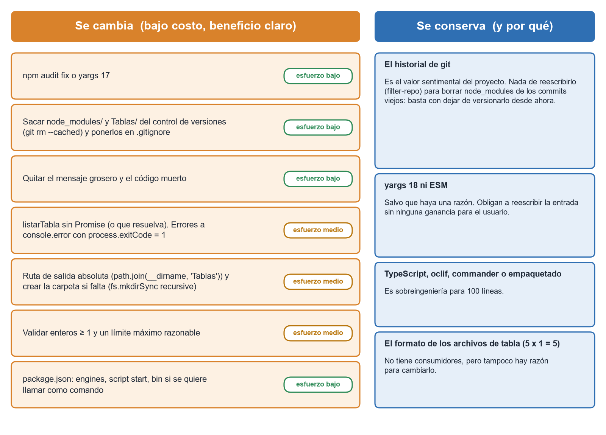
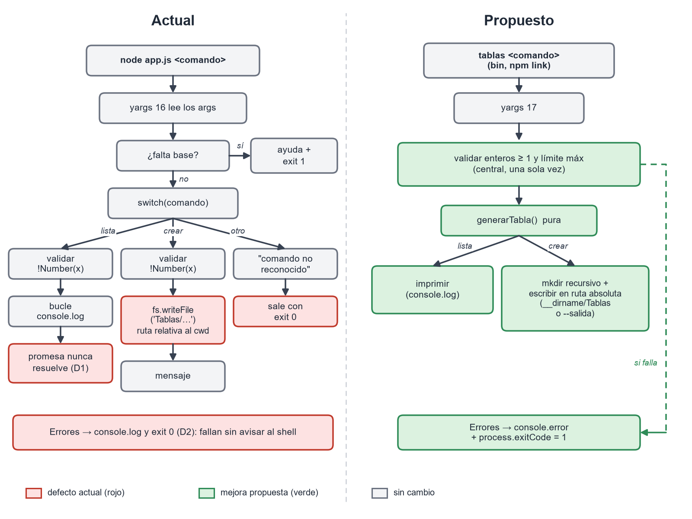
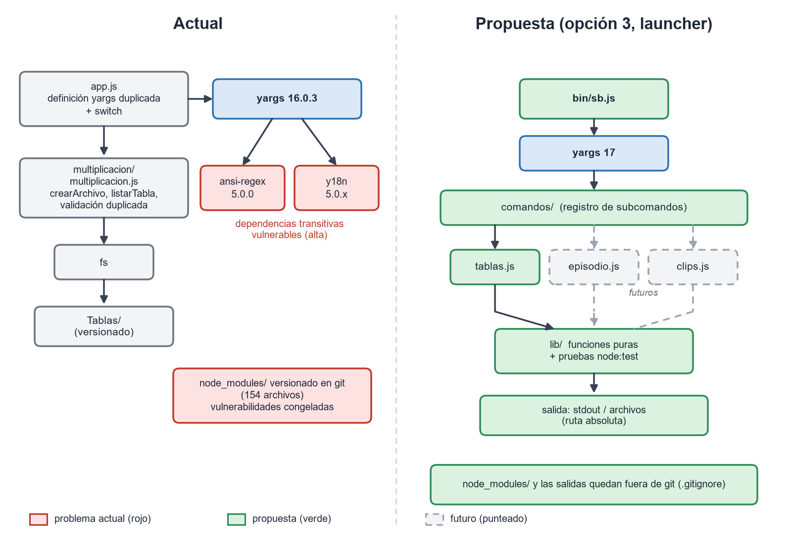
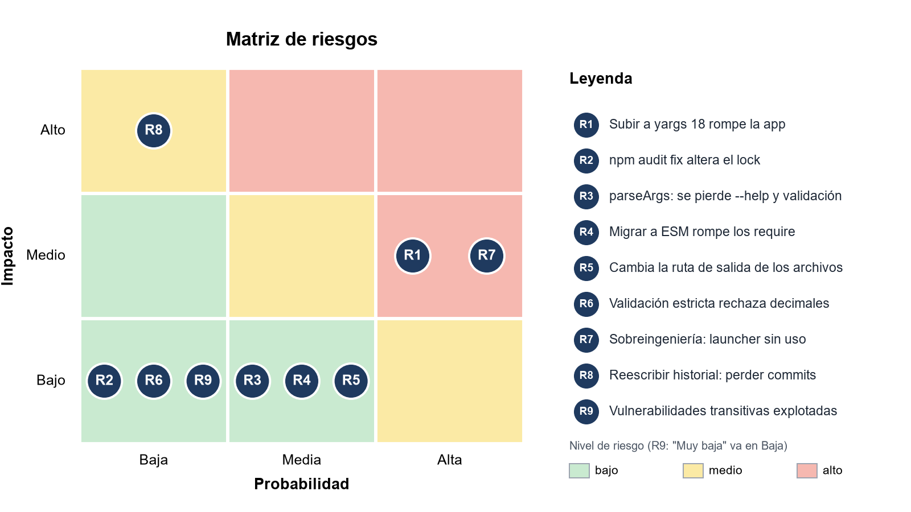

# Análisis de `001-bases-nodejs`

- Fecha: 2026-11-23
- Fase: 1, solo análisis. No se tocó el código, el `.git` ni el `node_modules` del proyecto. La app se ejecutó y auditó en una copia temporal.
- Anexo: `inventario.md` (inventario mecánico de archivos, versiones y git).

## 1. Resumen

`001-bases-nodejs` es un ejercicio de aprendizaje de Node.js de noviembre de 2020 (4 commits entre el 6 y el 9 de noviembre). Es una CLI que imprime o guarda en archivo la tabla de multiplicar de un número. Son unas 100 líneas de código propio y una sola dependencia: **`yargs` 16.0.3**, no `inquirer`. Se acordaba bien de lo "Pirate": la documentación de yargs está escrita en voz de pirata ("Yargs be a node.js library fer hearties…"). yargs no arma menús interactivos: lee los argumentos de la línea de comandos (`lista -b 5 -l 20`).

La app funciona hoy con Node 24 tal como está. Tiene 2 vulnerabilidades altas en dependencias transitivas que `npm audit fix` resuelve sin romper nada. También tiene varios errores pequeños de lógica y de higiene del repositorio.

**Recomendación:** no rediseñarla como herramienta. Hacer el mantenimiento mínimo (opción 1, cerca de una hora) para dejarla limpia como recuerdo de aprendizaje. Si quieres una CLI personal, empieza una aparte (opción 3) solo cuando tengas al menos 3 tareas reales que repites a mano. Los detalles están en la sección 7.

## 2. Qué hace hoy

| Comando | Qué hace | Resultado probado |
|---|---|---|
| `node app.js lista -b 3 -l 3` | Imprime `3 x 1 = 3` … hasta el límite (10 si no se da) | Funciona, pero deja una línea en blanco entre renglones (`\n` extra dentro de `console.log`) |
| `node app.js crear -b 5 -l 3` | Escribe `Tablas/Tabla-5.txt` | Funciona e imprime un mensaje grosero de confirmación |
| `node app.js lista` (sin base) | yargs muestra la ayuda y "Missing required argument: base" | Bien, sale con código 1 |
| `node app.js --help` | Ayuda automática de yargs | Bien |
| `node app.js` (sin comando) | "comando no reconocido" | Sale con código 0 (debería ser ≠ 0) |

Estructura:

```
app.js                        ← define los comandos con yargs y despacha con un switch
multiplicacion/multiplicacion.js ← crearArchivo() y listarTabla(), ambas devuelven Promise
Tablas/                       ← salidas generadas (5 archivos versionados)
node_modules/                 ← versionado en git por error (154 archivos)
```

`info.md` solo dice: instalar Node, programar y correr con `nodemon`. `nodemon` no está en las dependencias ni hay scripts en `package.json` (solo el `test` de relleno).

## 3. Estado actual y deuda técnica

Probado en la copia temporal (Node v24.15.0, npm 12.0.1):

| # | Problema | Evidencia | Gravedad |
|---|---|---|---|
| D1 | `listarTabla` nunca llama `resolve()`. La promesa queda colgada y el `.then()` vacío no hace nada | `multiplicacion.js` | Baja (el proceso termina igual) |
| D2 | Los errores se imprimen con `console.log` y el proceso sale con código 0 | base `abc`: exit 0 | Media si se usa en scripts |
| D3 | La ruta `Tablas/` es relativa al directorio actual, no a la app. Si se corre desde otra carpeta falla con `ENOENT` y aun así sale con 0 | Probado desde la carpeta padre | Media |
| D4 | Validación con `!Number(x)`: rechaza `0` ("número no válido"), acepta decimales (`2.5`), y un límite negativo imprime nada sin avisar | Probado | Baja |
| D5 | Lógica duplicada: los dos comandos repiten la validación y el bucle; las opciones de yargs están copiadas | `app.js`, `multiplicacion.js` | Baja |
| D6 | Código muerto: `const { alias } = require('yargs')` no se usa; comentarios "version mas mejor" | `app.js` | Cosmética |
| D7 | Mensaje grosero al crear archivo. **El repo es público en GitHub**, así que está a la vista | `app.js` | Social, no técnica |
| D8 | `crearArchivo` responde `tabla-5.txt` (minúscula) pero crea `Tabla-5.txt` | `multiplicacion.js` | Cosmética |
| D9 | `node_modules/` está versionado (commit inicial) aunque `.gitignore` lo excluye | `inventario.md` §7 | Media (repo inflado, vulnerabilidades congeladas en git) |
| D10 | `Tablas/` versionado con datos incoherentes: `Tabla-2.txt` contiene la tabla del 100; `Tabla-10.txt` tiene 4 líneas | `inventario.md` §5 | Baja (son salidas, no fuente) |
| D11 | Sin `engines`, sin scripts (`start`), sin pruebas, `lockfileVersion` 1 (npm 6) | `package.json`, lock | Baja |

Lo que está bien: es pequeña y se lee de corrido, separa la CLI (`app.js`) de la lógica (`multiplicacion/`), y yargs le da ayuda y validación de requeridos gratis.

## 4. Dependencias y vulnerabilidades

`npm audit` sobre la copia:

| Paquete | Versión | Severidad | Aviso | Directo |
|---|---|---|---|---|
| `ansi-regex` | 5.0.0 | Alta (CVSS 7.5, ReDoS) | GHSA-93q8-gq69-wqmw | No (vía yargs → cliui/string-width) |
| `y18n` | 5.0.0–5.0.4 | Alta (prototype pollution) | GHSA-c4w7-xm78-47vh | No (vía yargs) |

Riesgo real para una CLI personal que solo recibe tus propios argumentos: **casi nulo**. Ninguna de las dos se puede explotar sin entrada controlada por un atacante. Aun así conviene corregirlas porque no cuesta nada.

Qué se probó en copias temporales:

| Acción | Resultado |
|---|---|
| `npm audit fix` | 0 vulnerabilidades. La app sigue funcionando igual. Cambia solo el lock y node_modules |
| Subir a `yargs@17` | 0 vulnerabilidades, funciona **sin tocar código** |
| Subir a `yargs@18` (la más nueva, 18.2.0) | **Se rompe**: `TypeError: require(...).command is not a function`. La v18 quitó el uso directo con `require('yargs')`; habría que reescribir la entrada |
| Alternativa sin dependencias | `util.parseArgs` de Node (estable desde Node 20) resuelve las opciones, pero no genera `--help` ni subcomandos: hay que escribirlos a mano |

## 5. Qué conviene cambiar y qué no

**Cambiar** (bajo costo, beneficio claro):
- `npm audit fix` o yargs 17.
- Sacar `node_modules/` y `Tablas/` del control de versiones (`git rm --cached`) y ponerlos en `.gitignore`.
- Quitar el mensaje grosero y el código muerto.
- `listarTabla` sin Promise (o que resuelva). Errores a `console.error` con `process.exitCode = 1`.
- Ruta de salida absoluta (`path.join(__dirname, 'Tablas')`) y crear la carpeta si falta (`fs.mkdirSync(..., { recursive: true })`).
- Validar enteros ≥ 1 y un límite máximo razonable.
- `package.json`: `engines`, script `start`, `bin` si se quiere llamar como comando.

**No conviene cambiar:**
- **El historial de git.** Es el valor sentimental del proyecto. Nada de reescribirlo (`filter-repo`) para borrar `node_modules` de los commits viejos: basta con dejar de versionarlo desde ahora.
- **yargs 18 ni ESM**, salvo que haya una razón. Obligan a reescribir la entrada sin ninguna ganancia para el usuario.
- **TypeScript, frameworks de CLI (oclif, commander) o empaquetado.** Es sobreingeniería para 100 líneas.
- **El formato de los archivos de tabla** (`5 x 1 = 5`). No tiene consumidores, pero tampoco hay razón para cambiarlo.



## 6. Opciones de rediseño (de menor a mayor)

| Opción | Qué es | Esfuerzo | Riesgo | Valor para ti |
|---|---|---|---|---|
| **0. Archivar** | Dejarla como está, con un README de "ejercicio de 2020" | 5 min | Nulo | Recuerdo |
| **1. Mantenimiento mínimo** | `audit fix`, quitar grosería y código muerto, exit codes, ruta absoluta, sacar `node_modules`/`Tablas` de git | ~1 h | Bajo | Recuerdo limpio y repo público presentable |
| **2. Modernizar** | Opción 1 más yargs 17 (o `parseArgs`), función pura `generarTabla()` + `node:test`, `async/await` con `fs/promises`, `bin` para usarla con `npm link` | ½ día | Bajo-medio | Práctica de Node moderno, pero la herramienta sigue sin uso real |
| **3. CLI personal (launcher)** | Proyecto nuevo: un comando (`sb`, por ejemplo) con subcomandos en una carpeta `comandos/`; cada utilidad es un archivo. Las tablas pueden ser un subcomando de muestra. Menú interactivo opcional con `@inquirer/prompts` | 1–3 días | Medio (sobre todo de abandono) | Alto **si** existen las tareas repetidas |
| **4. Otra herramienta** | Abandonar la idea de tablas: una TUI o una mini app web para lo que de verdad uses | Variable | Alto | Depende de la necesidad |





El flujo y la arquitectura "propuestos" de los diagramas son los de las opciones 2–3: entrada única, validación central, lógica pura, salida con ruta absoluta y códigos de salida correctos, y en la opción 3 un registro de subcomandos.

## 7. ¿Para qué te serviría de verdad? (investigación de utilidad)

Una tabla de multiplicar en consola no resuelve nada que no resuelva una calculadora. Su valor es didáctico. Lo que sí puede servir es el **patrón**: un comando propio que agrupe tus utilidades. Ideas según lo que se ve en tu entorno (series de programación en video, edición de figuras, proyectos de rediseño):

| Idea | Qué haría | ¿Ya existe algo? |
|---|---|---|
| Andamio de episodio | `sb episodio nuevo "nombre"` crea la carpeta con plantillas del guion y el plan, y la estructura de assets | Se puede hacer con una plantilla y copiar a mano |
| Ordenar clips | Renombrar o clasificar clips de cámara por fecha o tipo, y listar duración con `ffprobe` | Existen herramientas, pero no a tu medida |
| Lanzador de proyectos | `sb abrir 001` abre la carpeta del proyecto, el editor y la sesión que toca | Se puede hacer con alias de PowerShell |
| Chequeos rápidos | `sb audit` corre `npm audit` u `outdated` sobre todos tus proyectos Node | Un script de PowerShell de 10 líneas |
| Recordatorios o notas | `sb nota "..."` agrega una línea a un archivo de notas | Obsidian ya lo hace |

Comparación honesta: casi todo esto se puede hacer con **funciones o alias en tu perfil de PowerShell**, sin Node ni dependencias. Una CLI en Node gana solo si quieres ayuda automática, validación, menú interactivo o compartir la lógica con otros scripts de Node.

**Recomendación:**
1. **Ahora:** opción 1 (mantenimiento mínimo) para dejar el repo público limpio, o la opción 0 si no te importa. No rediseñar la tabla de multiplicar: no vale la pena como herramienta.
2. **Más adelante, y solo si se cumple la condición:** si durante un par de semanas anotas 3 o más tareas que repites a mano, empieza la opción 3 como **proyecto nuevo** (no sobre este repo), con la tabla como subcomando de ejemplo para no partir de cero. Si no llegas a 3, usa alias de PowerShell.

## 8. Riesgos

| # | Riesgo | Probabilidad | Impacto | Mitigación |
|---|---|---|---|---|
| R1 | Subir a yargs 18 rompe la app | Alta (si se sube a "latest") | Medio | Fijar `^17` o reescribir la entrada a propósito |
| R2 | `npm audit fix` cambia el lock de forma inesperada | Baja | Bajo | Ya probado: funciona igual |
| R3 | Pasar a `util.parseArgs` y perder `--help` y la validación automática | Media | Bajo | Quedarse con yargs 17, o escribir la ayuda a mano |
| R4 | Migrar a ESM rompe los `require` | Media | Bajo | No migrar sin motivo |
| R5 | Cambiar la ruta de salida hace que los archivos aparezcan en otro lugar | Media | Bajo | Documentarlo; opción `--salida` |
| R6 | Validación estricta rechaza entradas que antes servían (decimales) | Baja | Bajo | Decidir a propósito si se aceptan decimales |
| R7 | Sobreingeniería: el launcher se construye y no se usa | **Alta** | Medio | La condición de 3 tareas reales antes de empezar |
| R8 | Reescribir el historial para limpiar `node_modules` y perder commits | Baja | Alto | No reescribir; solo `git rm --cached` |
| R9 | Las vulnerabilidades transitivas se explotan | Muy baja | Bajo | `audit fix` |



## 9. Cómo se hizo

- Lectura directa de `app.js`, `multiplicacion.js`, `package.json` e `info.md`.
- Inventario mecánico (archivos, versiones, lock, `node_modules`, `Tablas/`, git) hecho por el becario: `inventario.md`.
- Ejecución de 10 escenarios, `npm audit`, `npm outdated`, `audit fix` y pruebas con yargs 17 y 18, todo en copias temporales fuera del proyecto.
